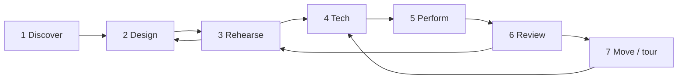

# Users and the user journey

Who uses Scrim, what each of them needs, and how a production moves through the app from a first idea to the last performance.

The five primary users come from the [product proposal](https://claude.ai/code/artifact/8e8f9f6f-ccc6-4e46-9b08-ce8778cfb65d)'s launch personas. The supporting users are the other people a real production involves. **Today** describes what the app does now; **Gaps** are things the journey needs that are not built yet.

## At a glance

| User                         | Role in the show                                | Where they work in Scrim                                                | Device                                          |
| ---------------------------- | ----------------------------------------------- | ----------------------------------------------------------------------- | ----------------------------------------------- |
| **Show designer**            | Builds the media, layouts and cue logic         | Library, editor (all tabs)                                              | Laptop, Chrome or Edge                          |
| **Director**                 | Shapes the moments in rehearsal                 | Operator view in rehearsal mode, stage preview                          | Looks over the operator's shoulder, or a laptop |
| **Stage manager / operator** | Runs the show live                              | Operator view, pre-show check, output windows                           | The show machine                                |
| **Performer**                | Triggers moments from the stage                 | Performer remote page                                                   | Their own phone, or a foot pedal                |
| **Audience member**          | Takes part in the story                         | Audience page (`audience.html`)                                         | Their own phone, any browser                    |
| _Production technician_      | Rigs projectors, screens, sound and the network | Outputs & audio tab, output windows, Identify, pre-show check           | Show machine and venue gear                     |
| _Lighting / sound designer_  | Owns the console and the sound system           | Not yet: planned [show-control output](research/show-control-output.md) | Their console or QLab machine                   |
| _Producer / company manager_ | Pays for, schedules and tours the show          | Library (backups, `.scrim` files); later, the cloud workspace           | Any                                             |

## Primary users

### Show designer

**Who.**

- In a small company this is often the director, a video designer, or a deviser with no programming background.
- They may use Isadora, QLab or PowerPoint today.

**Goals.**

- Get media onto the stage outputs quickly and lay it out.
- Express the show's logic (what happens on each cue, what an audience vote changes) without writing code.
- See the result without a projector.

**What they do in Scrim.**

1. **Create a show.**
   - Create one in the library, or open the **Demo show** to learn by example.
   - Import a `.scrim` file from a colleague.
2. **Stage tab.**
   - Add outputs, drop in media, and place image, video, text, counter and state layers.
   - Set crop, opacity and fit, and order layers by depth.
3. **Cues tab.** Group cues into scenes, and give each cue actions (show, hide, fade, play, set text, change a state value, jump scene…), auto-follow timings and notes.
4. **Interaction tab.**
   - Define state values.
   - Define audience moments (vote, tap, slider, text, personal prop), each with a default result.
   - Define performer triggers.
   - Write "when / if / then" rules.
5. **Controls tab.** Map keys, MIDI pads and gamepad buttons to GO, Hold, Panic or triggers.
6. **Stage preview.** Step through cues to see the picture after any cue.

**Needs.**

- Fast layout.
- Branching that reads like plain language.
- Previewing without hardware.
- Never losing work: autosave and version history.
- Moving a show between machines.

**Today.**

- All of the above.
- Autosave every 400 ms.
- Versions every 5 minutes, with restore.
- `.scrim` export and import.

**Gaps.**

- No collaboration: one person edits a show on one machine.
- No reusable templates beyond the demo.
- Effects, blend modes and projection warping wait for the [GPU compositor](research/gpu-compositor.md).

### Director

**Who.** Responsible for the piece as a whole. They don't build cues, but they decide when and how moments land.

**Goals.**

- Jump to any scene.
- Try a different timing.
- See what an audience choice does without gathering an audience.
- Leave notes for the designer and stage manager.

**What they do in Scrim (rehearsal mode in the operator view).**

- Click a cue to put it on standby, or double-click to fire it now.
- Scrub media, and override state values to force a branch.
- Use **Close now**, **Force** and **+10s** on audience moments to rehearse every outcome.
- Watch cues marked **changed since the last run** after the designer edits them live.

**Needs.**

- Speed: no waiting and no reloading.
- Confidence that what they rehearse is what will run.

**Today.**

- All of the above. Edits in the editor apply live to the running show.
- Notes are a field on each cue.

**Gaps.**

- No comments or threaded notes on cues.
- No remote viewing: the director has to be at the show machine.
- No way to save a "rehearsal bookmark" (a scene plus a state setup).

### Stage manager / operator

**Who.**

- Calls and runs the show every night.
- Often not technical.
- Under pressure during the show, with no time to think about software.

**Goals.**

- One GO key.
- A clear view of what's next.
- An instant way out (panic).
- No surprises.
- When something fails, a fix that takes one click.

**What they do in Scrim.**

1. **Before doors.**
   - **Run show**.
   - **Go live: open all**, so outputs open full screen on their displays.
   - **Identify** each output.
   - **Open audience room**.
   - Work through the **pre-show check** until it says READY.
   - Switch to **Show** mode, which locks editing.
2. **During the show.**
   - **GO** (Space, a pedal, or a key in an output window), with the standby cue and its notes shown above.
   - **Hold** pauses auto-follows and moment timers.
   - **PANIC** (Esc) blacks out every output and mutes all sound.
   - Moderate audience text entries, extend or close moments, and force a result if needed.
3. **When something goes wrong.**
   - **Reopen** a lost output.
   - Reload a crashed operator tab, and the show resumes at the same cue.
   - Carry on through a network outage, because moments fall back to their default results.

**Needs.**

- Nothing on the network on the critical path.
- A double-GO guard.
- Visible health for outputs, sound, phones and remotes.
- A runbook.

**Today.**

- All of the above. See the [operator guide](operator-guide.md) and the reliability rules in [architecture.md](architecture.md#reliability-rules).

**Gaps.**

- Lighting and sound cues are still called separately on other systems. Scrim can't fire the console yet ([research](research/show-control-output.md)).
- No calling script (a cue sheet with page references), and no printed or exported cue list.

### Performer

**Who.** An actor or dancer who triggers a moment from the stage, such as a door slam or the reveal of a clue.

**Goals.** A button that works the first time, every time, without looking at it for long.

**What they do in Scrim.**

- Scan the **performer QR code** once.
- Their phone shows big trigger buttons, the show name, and what's on standby.
- A press is acknowledged.
- Alternatively, a MIDI or gamepad foot pedal on the show machine is mapped to a trigger.

**Needs.**

- Reliability, and clear confirmation that a press arrived.
- Reconnecting on its own.
- A clear message when the link is no longer valid.

**Today.**

- All of the above. When the room is replaced, the phone says **Link no longer valid** and explains what to do.

**Gaps.**

- No per-performer view: every remote sees all triggers.
- No haptic or "armed" state to stop accidental presses.

### Audience member

**Who.**

- Anyone in the room, with whatever phone they brought.
- No install, no account, little patience, often on poor venue Wi-Fi.

**Goals.**

- Join in seconds.
- Understand what to do.
- See their input change the stage within about a second.

**What they do in Scrim.**

1. Scan the QR code on the screen or programme, or type the five-letter room code.
2. Wait on a calm "Joined" screen until a moment opens.
3. Vote, tap, slide, write a short text, or read the personal prop their phone was given.
4. Watch the result happen on stage.

**Needs.**

- Works in any modern browser, Safari included.
- Large touch targets.
- Survives a reload without losing their vote.
- Respects privacy: anonymous, no sign-up.

**Today.**

- All of the above.
- The audience page is a separate light bundle.
- The phone id is kept in `localStorage`, so votes survive a reload.
- Past answers are cleared when a moment closes.
- Load-tested at 200 phones, with a p95 of about 200 ms from vote to operator.

**Gaps.**

- No language switching.
- No accessibility review yet (screen readers, contrast, motion).
- No custom branding.

## Supporting users

### Production technician

- **What they do:**
  - Rigs projectors and screens.
  - Assigns outputs to displays (**Detect displays**).
  - Sets audio devices per bus.
  - Sets keystone with corner pin.
  - Brings a dedicated Wi-Fi router for large audiences.
  - Imports the `.scrim` file onto remote output devices.
- **Today:** the Outputs & audio tab, Identify, the pre-show check, and per-machine settings that are not saved in the show.
- **Gaps:**
  - No mesh warp, edge blending or test patterns ([GPU compositor research](research/gpu-compositor.md)).
  - Media must be copied to remote outputs by hand.

### Lighting and sound designers

- **Situation:** they own their own systems (a lighting console, QLab), and today they work alongside Scrim, not with it.
- **What they will need:** Scrim cues that fire their cues (MIDI Show Control, OSC). Panic must not silently kill the house lights. They need a log of what was sent.
- **Status:** planned; see [show-control output research](research/show-control-output.md).

### Producer / company manager

- **Situation:** cares that the show can be backed up, moved to a new venue, toured and paid for.
- **Today:**
  - `.scrim` export as the master copy.
  - **Keep my shows** for persistent storage.
  - Run logs per performance.
- **Gaps:**
  - No cloud workspace, roles or sharing.
  - No reports across performances.
  - No billing (see the proposal's business model).

## The overarching journey

A production moves through seven stages. Different users lead each one, but the same show file carries through all of them.

Design and rehearsal loop many times. Review feeds the next rehearsal. Touring returns to tech in each new venue.

### Who is involved at each stage

| Stage         | Designer | Director | Stage manager | Performer | Audience | Technician | Producer |
| ------------- | :------: | :------: | :-----------: | :-------: | :------: | :--------: | :------: |
| 1 Discover    |    ●     |    ○     |               |           |          |            |    ○     |
| 2 Design      |    ●     |    ○     |               |           |          |            |          |
| 3 Rehearse    |    ●     |    ●     |       ●       |     ○     |          |            |          |
| 4 Tech        |    ○     |    ○     |       ●       |     ●     |          |     ●      |          |
| 5 Perform     |          |          |       ●       |     ●     |    ●     |     ○      |          |
| 6 Review      |    ●     |    ●     |       ●       |           |          |            |    ○     |
| 7 Move / tour |          |          |       ○       |           |          |     ●      |    ●     |

● leads or is essential · ○ takes part

### 1. Discover

- **Who:** the designer, sometimes with the producer.
- **Goal:** find out in minutes whether Scrim can do their show.
- **Steps:**
  1. Open the link.
  2. Open the **Demo show**.
  3. Press GO and watch an output open in a second window.
  4. Try a vote from their own phone.
- **Moment of truth:** the first cue firing on a second screen. The proposal's activation metric is reaching this in the first session.
- **Today:**
  - The demo show includes a vote, a branch and a performer trigger.
  - The app works offline once loaded.
  - The library asks to keep shows persistently.
- **Risks and gaps:**
  - Phones need the machine's LAN address or a deployed relay; `localhost` won't reach them.
  - There is no hosted public instance yet.

### 2. Design

- **Who:** the designer, with the director giving input.
- **Goal:** turn the script and media into outputs, layers, cues, state and moments.
- **Steps:**
  - Create outputs.
  - Import media (stored on this machine in OPFS).
  - Lay out layers.
  - Build scenes and cues.
  - Add state values, audience moments, triggers and rules.
  - Map controls.
  - Check everything with the stage preview.
- **Moment of truth:** a branch works in preview. "If the vote says _left_, jump to scene 3" behaves as written.
- **Today:**
  - Autosave, undo and redo, and versions.
  - References can be left unfinished while designing; the engine skips them and warns.
- **Risks and gaps:**
  - Single-user only.
  - No templates.
  - Visual effects and mapping are limited by the DOM renderer.

### 3. Rehearse

- **Who:** the director, designer and stage manager together, with performers when needed.
- **Goal:** shape timing and moments; make sure every branch and default works.
- **Steps:**
  - Run the show in **Rehearsal** mode.
  - Jump around the cue list.
  - Scrub media and override state.
  - Force or close moments to test every outcome.
  - The designer edits live in the editor, and changed cues are marked in the operator view.
- **Moment of truth:** the director asks "what if the audience picks B?" and sees it in seconds.
- **Today:** all of the above. Edits reach the running show through the local channel, without restarting.
- **Risks and gaps:**
  - Notes are per cue and not threaded.
  - Nobody can follow along from another device.

### 4. Tech

- **Who:** the technician and stage manager lead; performers and the designer support.
- **Goal:** move the show from laptop screens to the real stage, and prove that everything works there.
- **Steps:**
  1. Connect projectors and screens.
  2. Use **Detect displays** and assign outputs.
  3. **Go live: open all**.
  4. Run **Identify**.
  5. Keystone with corner pin.
  6. Pick an audio device per bus.
  7. Map pedals.
  8. Open the audience room.
  9. Hand out the performer QR code.
  10. Test with real phones on the venue Wi-Fi.
  11. Export a `.scrim` backup.
  12. Work through the pre-show check.
- **Moment of truth:** the pre-show check says **READY** on the real machine, in the real room.
- **Today:**
  - The pre-show check covers media, storage, outputs, sound, sleep, controllers and the audience room.
  - Display assignments are remembered per machine.
- **Risks and gaps:**
  - Lighting and sound consoles are not connected ([research](research/show-control-output.md)).
  - No mesh warp or multi-projector blending ([research](research/gpu-compositor.md)).
  - Media for remote outputs is copied by hand.

### 5. Perform

- **Who:** the stage manager, performers and audience; the technician stands by.
- **Goal:** run the show exactly as rehearsed, and recover from anything without the audience noticing.
- **Steps:**
  1. Switch to **Show** mode.
  2. Doors open; the audience joins by QR code.
  3. The stage manager presses GO cue by cue.
  4. Moments open, phones light up, and results branch the show.
  5. Performers fire their triggers.
- **The audience member's journey inside this stage:**
  1. Scan the QR code from their seat.
  2. See "Joined".
  3. A moment opens, and they vote.
  4. Within about a second, the tally moves on stage.
  5. The moment closes, the stage changes, and the phone returns to waiting.
- **Moment of truth:** the vote lands on stage within a second, every night.
- **Recovery:**
  - Panic for emergencies.
  - **Reopen** for lost outputs.
  - Crash resume for the operator tab.
  - Default results when the network fails.
  - Hold for an unexpected pause.
- **Today:** all of the above, plus a 300 ms double-GO guard, a wake lock, and a single operator per show per machine.
- **Risks and gaps:**
  - The audience page has no language choice.
  - There is no accessibility pass yet.

### 6. Review

- **Who:** the director, designer and stage manager.
- **Goal:** learn from the night and fix things before the next performance.
- **Steps:**
  1. Open the **History** tab.
  2. Read the run log: every cue fired, every audience result, every warning.
  3. Adjust cues or defaults.
  4. Go back to rehearsal.
- **Moment of truth:** a warning in the log explains a glitch the stage manager noticed.
- **Today:** a run log per operator session, stored on the machine.
- **Risks and gaps:**
  - No reports across performances (for example, how audiences voted over the whole run).
  - Logs stay on one machine.

### 7. Move and tour

- **Who:** the producer and technician.
- **Goal:** run the same show on another machine or in another venue, possibly months later.
- **Steps:**
  1. Export the `.scrim` file.
  2. Import it on the new machine.
  3. Redo the per-machine setup: display assignments, audio devices, keystone.
  4. Go back to tech.
- **Moment of truth:** the show opens on a fresh machine with all its media, and runs.
- **Today:**
  - The `.scrim` format is open, versioned and migrated forward ([show-format.md](show-format.md)).
  - Media is bundled byte for byte.
- **Risks and gaps:**
  - No cloud sync.
  - Keystone and display setup are per machine and must be redone for each new venue.

## Music and live events

The same set of users covers a band's live show, but in a different shape. Theatre is driven by a stage manager calling cues. A gig is driven by **the music's timing**, and often has no dedicated operator at all. The proposal lists this as the later "Live visuals (VJ)" use case.

### How the users map

| Theatre user              | Band equivalent                                       | What changes                                                                                                                            |
| ------------------------- | ----------------------------------------------------- | --------------------------------------------------------------------------------------------------------------------------------------- |
| Show designer             | Visual designer / content creator                     | Same work, but organised as content per song, often for LED walls rather than projectors                                                |
| Director                  | Creative director, or the band itself                 | Fewer rehearsals. Decisions are made on production days                                                                                 |
| Stage manager / operator  | VJ / visual operator at front of house, or **nobody** | Many bands run without an operator: visuals follow the playback rig (the laptop running backing tracks) or the drummer's click          |
| Performer                 | Band member                                           | Triggers much more, and hands-free: foot pedals, MIDI from instruments, the playback laptop                                             |
| Audience member           | Fans                                                  | Larger crowds and worse Wi-Fi. Moments are song votes, phone light shows, sing-along lyrics                                             |
| Production technician     | Video and lighting crew                               | Usually rigs LED walls and a lighting console every night                                                                               |
| Lighting / sound designer | Lighting designer at front of house                   | A lighting console is on almost every show, so [show-control output](research/show-control-output.md) matters even more than in theatre |
| Producer                  | Tour / production manager                             | Touring is the normal case: a new venue every night                                                                                     |

### How the journey changes

- **Design:** organised by song rather than by scene, with media cut to the track's tempo.
- **Rehearse:** shorter, done in production rehearsals rather than weeks of rehearsal.
- **Tech:** happens again **every night** in a new venue, so a fast, repeatable setup matters more than anything else:
  - display assignments;
  - warping;
  - the audience room.
- **Perform:**
  - **The setlist changes on the fly.** Songs are reordered, skipped or extended. Scenes work as songs, but jumping and reordering must be fast and safe while live.
  - **Timing comes from the music:**
    - beat sync with the band's rig (MIDI clock or Ableton Link);
    - following the playback rig's timecode (MIDI Timecode or LTC);
    - visuals that react to the live audio.
  - **Recovery:** if the playback rig stops, visuals must keep running gracefully rather than freeze.
- **Review:** less about fixing cues, more about which songs and moments landed.

### What Scrim would need

None of these exist yet:

1. **Tempo sync:** cues, follows and effects timed in beats and bars, locked to MIDI clock or Ableton Link.
2. **Timecode chase:** cues fire at timecode positions sent by the playback rig. This needs care, because browser timers jitter.
3. **Setlist mode:** reorder, skip and jump between songs live, safely.
4. **Audio-reactive visuals:** a live audio input analysed for level, bands and beat, driving effects. This depends on the [GPU compositor](research/gpu-compositor.md).
5. **Lyrics and captions:** a text layer that follows the song's timeline.
6. **Fast venue setup:** saved per-venue output profiles that can be reapplied in minutes.

Scrim's model already fits: outputs, layers, cues, show state, audience moments and triggers all apply as they are. The work is in timing and the live setlist, not in a new model.

## What the journey tells us

- **Most gaps sit in Tech and in collaboration, not in running.** The live path (Perform) is the most complete part of the app, which is right for a show-control tool.
- **The next research topics map onto the journey:**
  - [Show-control output](research/show-control-output.md) closes the biggest Tech gap for stage managers and lighting/sound designers.
  - The [GPU compositor](research/gpu-compositor.md) closes the Tech gaps for technicians (warping, blending) and the Design gaps for designers (effects).
  - Both are also prerequisites for [music and live events](#music-and-live-events), which then need timing (tempo sync, timecode) and a live setlist.
- **Collaboration helps three stages at once.** A cloud workspace with roles and comments would help Design, Rehearse and Review, and would serve the director, who is the user Scrim supports least today.
