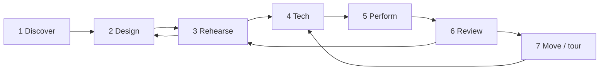

# Users and the user journey

Who uses Scrim, what each of them needs, and how a production moves through the app from a first idea to the last performance.

The five primary users come from the [product proposal](https://claude.ai/code/artifact/8e8f9f6f-ccc6-4e46-9b08-ce8778cfb65d)'s launch personas. The supporting users are the other people a real production involves. Later sections cover [music and live events](#music-and-live-events), [other places Scrim is used](#other-places-scrim-is-used), from classrooms to care homes, and the [ideas that make Scrim accessible to all](#accessible-to-all) of them. **Today** describes what the app does now; **Gaps** are things the journey needs that are not built yet.

## At a glance

| User                         | Role in the show                                | Where they work in Scrim                                                | Device                                          |
| ---------------------------- | ----------------------------------------------- | ----------------------------------------------------------------------- | ----------------------------------------------- |
| **Show designer**            | Builds the media, layouts and cue logic         | Library, editor (all tabs)                                              | Laptop, Chrome or Edge                          |
| **Director**                 | Shapes the moments in rehearsal                 | Operator view in rehearsal mode, stage preview                          | Looks over the operator's shoulder, or a laptop |
| **Stage manager / operator** | Runs the show live                              | Operator view, pre-show check, output windows                           | The show machine                                |
| **Performer**                | Triggers moments from the stage                 | Performer remote page                                                   | Their own phone, or a foot pedal                |
| **Audience member**          | Takes part in the story                         | Audience page (`audience.html`)                                         | Their own phone, any browser                    |
| _Production technician_      | Rigs projectors, screens, sound and the network | Outputs & audio tab, output windows, Identify, pre-show check           | Show machine and venue gear                     |
| _Lighting / sound designer_  | Owns the console and the sound system           | Not yet: planned [show-control output](research/show-control-output.md) | Their console or QLab machine                   |
| _Producer / company manager_ | Pays for, schedules and tours the show          | Library (backups, `.scrim` files); later, the cloud workspace           | Any                                             |
| _Front-of-house and ushers_  | Welcome the audience and help them take part    | Not yet: a planned front-of-house view                                  | Their own phone, shared venue tablets           |

## Primary users

### Show designer

**Who.**

- In a small company this is often the director, a video designer, or a deviser with no programming background.
- They may use Isadora, QLab or PowerPoint today.

**Goals.**

- Get media onto the stage outputs quickly and lay it out.
- Express the show's logic (what happens on each cue, what an audience vote changes) without writing code.
- See the result without a projector.

**What they do in Scrim.**

1. **Create a show.**
   - Create one in the library, or open the **Demo show** to learn by example.
   - Import a `.scrim` file from a colleague.
2. **Stage tab.**
   - Add outputs, drop in media, and place image, video, text, counter and state layers.
   - Set crop, opacity and fit, and order layers by depth.
3. **Cues tab.** Group cues into scenes, and give each cue actions (show, hide, fade, play, set text, change a state value, jump scene…), auto-follow timings and notes.
4. **Interaction tab.**
   - Define state values.
   - Define audience moments (vote, tap, slider, text, personal prop), each with a default result.
   - Define performer triggers.
   - Write "when / if / then" rules.
5. **Controls tab.** Map keys, MIDI pads and gamepad buttons to GO, Hold, Panic or triggers.
6. **Stage preview.** Step through cues to see the picture after any cue.

**Needs.**

- Fast layout.
- Branching that reads like plain language.
- Previewing without hardware.
- Never losing work: autosave and version history.
- Moving a show between machines.

**Today.**

- All of the above.
- Autosave every 400 ms.
- Versions every 5 minutes, with restore.
- `.scrim` export and import.
- A **template gallery** with a whole show for each user below: real public-domain pictures, music and video, the settings that user needs, and a Learn checklist for making it theirs. Plus the demo, three small starters, and **Save as template** on this machine. A show made from a template gets ids of its own.
- **Wizards** that build ordinary cues, layers and rules: a song, a photo story, notices, a quiz question, and a choice point.
- **Import scenes** from another `.scrim` file, with everything their cues use.
- A **simple editor** that folds rules, values and mappings one labelled step away.
- The **Access** tab: captions, audio description, content warnings and translations against the cue list.
- Gentler versions of cues and **intense** layers for relaxed performances, and a **flash check** on cue timings.

**Gaps.**

- No collaboration: one person edits a show on one machine.
- Saved templates stay on one machine, and the gallery's templates come with the app; there's no community sharing yet.
- Effects, blend modes and projection warping wait for the [GPU compositor](research/gpu-compositor.md).

### Director

**Who.** Responsible for the piece as a whole. They don't build cues, but they decide when and how moments land.

**Goals.**

- Jump to any scene.
- Try a different timing.
- See what an audience choice does without gathering an audience.
- Leave notes for the designer and stage manager.

**What they do in Scrim (rehearsal mode in the operator view).**

- Click a cue to put it on standby, or double-click to fire it now.
- Scrub media, and override state values to force a branch.
- Use **Close now**, **Force** and **+10s** on audience moments to rehearse every outcome.
- Watch cues marked **changed since the last run** after the designer edits them live.

**Needs.**

- Speed: no waiting and no reloading.
- Confidence that what they rehearse is what will run.

**Today.**

- All of the above. Edits in the editor apply live to the running show.
- Notes are a field on each cue.
- **Back** undoes the last GO, one step. A key or pedal can jump to a scene, or to a section of the scene that is live (the next chorus).
- Tonight's running order can be changed live: reorder or skip scenes, or switch to a prepared setlist.

**Gaps.**

- No comments or threaded notes on cues.
- No remote viewing: the director has to be at the show machine.
- Rehearsal bookmarks are partial. **Save this path** in the editor's _After this cue_ keeps a cue and the moment results that lead there, and **Rehearse from here** hands them to the operator view. A path can't hold other values, and the operator view can't open one.

### Stage manager / operator

**Who.**

- Calls and runs the show every night.
- Often not technical.
- Under pressure during the show, with no time to think about software.

**Goals.**

- One GO key.
- A clear view of what's next.
- An instant way out (panic).
- No surprises.
- When something fails, a fix that takes one click.

**What they do in Scrim.**

1. **Before doors.**
   - **Run show**.
   - **Go live: open all**, so outputs open full screen on their displays.
   - **Identify** each output.
   - **Open audience room**.
   - Work through the **pre-show check** until it says READY.
   - Switch to **Show** mode, which locks editing.
2. **During the show.**
   - **GO** (Space, a pedal, or a key in an output window), with the standby cue and its notes shown above.
   - **Hold** pauses auto-follows and moment timers.
   - **PANIC** (Esc) blacks out every output and mutes all sound.
   - Moderate audience text entries, extend or close moments, and force a result if needed.
3. **When something goes wrong.**
   - **Reopen** a lost output.
   - Reload a crashed operator tab, and the show resumes at the same cue.
   - Carry on through a network outage, because moments fall back to their default results.

**Needs.**

- Nothing on the network on the critical path.
- A double-GO guard.
- Visible health for outputs, sound, phones and remotes.
- A runbook.

**Today.**

- All of the above. See the [operator guide](operator-guide.md) and the reliability rules in [architecture.md](architecture.md#reliability-rules).
- **Back**, PANIC's secondary clears (text, media, sound) and a live **running order** with setlists.
- A **simple view** for tablets and nervous volunteers: one huge GO, now and next, Hold, Back and PANIC.
- GO can wait for a **hold** of a key, pedal or button, against accidental presses.
- A screen-reader **announcer** reads what fired and what is next.
- A **Relaxed** switch for relaxed performances (a one-second hold in Show mode).
- Counts from people without a phone: arcade-style buttons mapped to vote options, and counts the operator types in.

**Gaps.**

- Lighting and sound cues are still called separately on other systems. Scrim can't fire the console yet ([research](research/show-control-output.md)).
- No calling script (a cue sheet with page references), and no printed or exported cue list.

### Performer

**Who.** An actor or dancer who triggers a moment from the stage, such as a door slam or the reveal of a clue.

**Goals.** A button that works the first time, every time, without looking at it for long.

**What they do in Scrim.**

- Scan the **performer QR code** once.
- Their phone shows big trigger buttons, the show name, and what's on standby.
- A press is acknowledged.
- Alternatively, a MIDI or gamepad foot pedal on the show machine is mapped to a trigger.

**Needs.**

- Reliability, and clear confirmation that a press arrived.
- Reconnecting on its own.
- A clear message when the link is no longer valid.

**Today.**

- All of the above. When the room is replaced, the phone says **Link no longer valid** and explains what to do.
- The phone vibrates on a press and shows **Sent ✓** once the operator has it.
- A trigger that a cue waits for reads **Not yet** until that cue is on standby, then **Your cue · tap Ready**.
- When the show allows **Remote GO**, a remote can press GO, Hold and Back: for a leader running the show from a tablet.

**Gaps.**

- No per-performer view: every remote sees all triggers.
- Other triggers fire on the first touch, with no "armed" state.

### Audience member

**Who.**

- Anyone in the room, with whatever phone they brought.
- No install, no account, little patience, often on poor venue Wi-Fi.

**Goals.**

- Join in seconds.
- Understand what to do.
- See their input change the stage within about a second.

**What they do in Scrim.**

1. Scan the QR code on the screen or programme, or type the five-letter room code.
2. Wait on a calm "Joined" screen until a moment opens.
3. Vote, tap, slide, write a short text, or read the personal prop their phone was given.
4. Watch the result happen on stage.

**Needs.**

- Works in any modern browser, Safari included.
- Large touch targets.
- Survives a reload without losing their vote.
- Respects privacy: anonymous, no sign-up.

**Today.**

- All of the above.
- The audience page is a separate light bundle.
- The phone id is kept in `localStorage`, so votes survive a reload.
- Past answers are cleared when a moment closes.
- Load-tested at 200 phones, with a p95 of about 200 ms from vote to operator.
- An **Access** menu on the phone: the show's language (the page's own words follow it, right to left for Arabic and the like), captions, text size, audio description read by the phone's own voice, vibration and content warnings. Each person's choices stay on their phone. See the [personal access channel](#1-a-personal-access-channel-on-the-audience-phone).
- In a relaxed performance the phone says so, and that it's OK to step out and come back.
- People without a phone take part through a shared tablet (each answer counts as one person), buttons in the room, or a raised hand the operator counts.

**Gaps.**

- The page's own words ship in English, Spanish, French and Arabic; the packs need a native speaker's review.
- No screen-reader pass on the phone yet beyond labels and live captions.
- No custom branding.

## Supporting users

### Production technician

- **What they do:**
  - Rigs projectors and screens.
  - Assigns outputs to displays (**Detect displays**).
  - Sets audio devices per bus.
  - Sets keystone with corner pin.
  - Brings a dedicated Wi-Fi router for large audiences.
  - Imports the `.scrim` file onto remote output devices.
- **Today:**
  - The Outputs & audio tab, Identify, and per-machine settings that are not saved in the show (display assignments and audio devices). The corner pin is saved in the show.
  - The pre-show check, which also says when the browser or an administrator blocks window placement, pop-ups, full screen or MIDI, and names the Chrome policy.
  - For unattended machines, an installation page and the [installation guide](installation-guide.md): kiosk flags, policies, autostart and power-loss recovery.
- **Gaps:**
  - No mesh warp, edge blending or test patterns ([GPU compositor research](research/gpu-compositor.md)).
  - Media must be copied to remote outputs by hand.
  - Identify works only for output windows on the show machine, not for remote outputs.

### Lighting and sound designers

- **Situation:** they own their own systems (a lighting console, QLab), and today they work alongside Scrim, not with it.
- **What they will need:** Scrim cues that fire their cues (MIDI Show Control, OSC). Panic must not silently kill the house lights. They need a log of what was sent.
- **Status:** planned; see [show-control output research](research/show-control-output.md).

### Producer / company manager

- **Situation:** cares that the show can be backed up, moved to a new venue, toured and paid for.
- **Today:**
  - `.scrim` export as the master copy.
  - **Keep my shows** for persistent storage.
  - Run logs per performance.
- **Gaps:**
  - No cloud workspace, roles or sharing.
  - No reports across performances.
  - No billing (see the proposal's business model).

### Front-of-house and usher team

- **Who:** ushers, box office staff, the front-of-house manager and, in many venues, an access officer on the night.
- **Situation:** they are the people the audience asks when joining fails, when the captions won't appear, or when someone has no phone. Today they have no part in Scrim at all.
- **Their journey:**
  1. **Before doors:**
     - put out QR code signs;
     - charge the shared tablets and clickers;
     - check the room is open and phones can join.
  2. **As people arrive:**
     - help them join;
     - set up their [personal access channel](#1-a-personal-access-channel-on-the-audience-phone) (captions, language, audio description);
     - hand out shared devices to people [without a phone](#4-no-phone-participation).
  3. **During the show:**
     - watch the room status;
     - help phones that dropped out to rejoin;
     - enter a hands-up count when a moment asks for one.
  4. **After the show:** collect devices, and pass on access feedback.
- **Needs:**
  - A **front-of-house view** on their own phone, with no show controls:
    - room status, number of phones joined, and the moment now open;
    - a "how to join" help card;
    - a plain explanation of each access option.
  - A way to submit counts for no-phone participation.
- **Today:** no view of their own. The operator's audience panel gives a QR code for a shared tablet passed from person to person, and takes the counts ushers call in (raised hands, coloured cards).
- **Gaps:** a front-of-house role in the relay. It would be like the performer remote: a key from the operator, and a limited view.

## The overarching journey

A production moves through seven stages. Different users lead each one, but the same show file carries through all of them.

Design and rehearsal loop many times. Review feeds the next rehearsal. Touring returns to tech in each new venue.

### Who is involved at each stage

| Stage         | Designer | Director | Stage manager | Performer | Audience | Technician | Producer | Front of house |
| ------------- | :------: | :------: | :-----------: | :-------: | :------: | :--------: | :------: | :------------: |
| 1 Discover    |    ●     |    ○     |               |           |          |            |    ○     |                |
| 2 Design      |    ●     |    ○     |               |           |          |            |          |                |
| 3 Rehearse    |    ●     |    ●     |       ●       |     ○     |          |            |          |                |
| 4 Tech        |    ○     |    ○     |       ●       |     ●     |          |     ●      |          |       ○        |
| 5 Perform     |          |          |       ●       |     ●     |    ●     |     ○      |          |       ●        |
| 6 Review      |    ●     |    ●     |       ●       |           |          |            |    ○     |       ○        |
| 7 Move / tour |          |          |       ○       |           |          |     ●      |    ●     |                |

● leads or is essential · ○ takes part

### 1. Discover

- **Who:** the designer, sometimes with the producer.
- **Goal:** find out in minutes whether Scrim can do their show.
- **Steps:**
  1. Open [scrim.shab.boo](https://scrim.shab.boo).
  2. Open the **Demo show**.
  3. Press GO and watch an output open in a second window.
  4. Try a vote from their own phone.
- **Moment of truth:** the first cue firing on a second screen. The proposal's activation metric is reaching this in the first session.
- **Today:**
  - The demo show includes a vote, a branch and a performer trigger.
  - The app works offline once loaded.
  - The library asks to keep shows persistently.
- **Risks and gaps:**
  - On a show machine, phones need that machine's LAN address; `localhost` won't reach them.
  - The public app is [scrim.shab.boo](https://scrim.shab.boo). Its relay is [relay.scrim.shab.boo](https://relay.scrim.shab.boo).

### 2. Design

- **Who:** the designer, with the director giving input.
- **Goal:** turn the script and media into outputs, layers, cues, state and moments.
- **Steps:**
  - Create outputs.
  - Import media (stored on this machine in OPFS).
  - Lay out layers.
  - Build scenes and cues.
  - Add state values, audience moments, triggers and rules.
  - Map controls.
  - Check everything with the stage preview.
- **Moment of truth:** a branch works in preview. "If the vote says _left_, jump to scene 3" behaves as written.
- **Today:**
  - Autosave, undo and redo, and versions.
  - References can be left unfinished while designing; the engine skips them and warns.
  - Wizards build a song, a photo story, notices, a quiz question or a choice point in one go, and scenes can be imported from another show.
  - The logic check also catches cue loops with no time between, and the flash check catches cues that flash more than three times a second.
- **Risks and gaps:**
  - Single-user only.
  - Templates come with the app; communities can't share their own through the gallery yet.
  - Visual effects and mapping are limited by the DOM renderer.

### 3. Rehearse

- **Who:** the director, designer and stage manager together, with performers when needed.
- **Goal:** shape timing and moments; make sure every branch and default works.
- **Steps:**
  - Run the show in **Rehearsal** mode.
  - Jump around the cue list.
  - Scrub media and override state.
  - Force or close moments to test every outcome.
  - The designer edits live in the editor, and changed cues are marked in the operator view.
- **Moment of truth:** the director asks "what if the audience picks B?" and sees it in seconds.
- **Today:** all of the above. Edits reach the running show through the local channel, without restarting.
- **Risks and gaps:**
  - Notes are per cue and not threaded.
  - Nobody can follow along from another device.

### 4. Tech

- **Who:** the technician and stage manager lead; performers and the designer support.
- **Goal:** move the show from laptop screens to the real stage, and prove that everything works there.
- **Steps:**
  1. Connect projectors and screens.
  2. Use **Detect displays** and assign outputs.
  3. **Go live: open all**.
  4. Run **Identify**.
  5. Keystone with corner pin.
  6. Pick an audio device per bus.
  7. Map pedals.
  8. Open the audience room.
  9. Hand out the performer QR code.
  10. Test with real phones on the venue Wi-Fi.
  11. Export a `.scrim` backup.
  12. Work through the pre-show check.
- **Moment of truth:** the pre-show check says **READY** on the real machine, in the real room.
- **Today:**
  - The pre-show check covers the logic check, flashing, media, storage, outputs, sound, what the browser allows, open captions, a relaxed performance, Remote GO, wake lock and sleep, controllers, the audience room, the offline cache and Show mode.
  - Display assignments are remembered per machine.
- **Risks and gaps:**
  - Lighting and sound consoles are not connected ([research](research/show-control-output.md)).
  - No mesh warp or multi-projector blending ([research](research/gpu-compositor.md)).
  - Media for remote outputs is copied by hand.

### 5. Perform

- **Who:** the stage manager, performers and audience; the technician stands by.
- **Goal:** run the show exactly as rehearsed, and recover from anything without the audience noticing.
- **Steps:**
  1. Switch to **Show** mode.
  2. Doors open; the audience joins by QR code.
  3. The stage manager presses GO cue by cue.
  4. Moments open, phones light up, and results branch the show.
  5. Performers fire their triggers.
- **The audience member's journey inside this stage:**
  1. Scan the QR code from their seat.
  2. See "Joined".
  3. A moment opens, and they vote.
  4. Within about a second, the tally moves on stage.
  5. The moment closes, the stage changes, and the phone returns to waiting.
- **Moment of truth:** the vote lands on stage within a second, every night.
- **Recovery:**
  - Panic for emergencies.
  - **Reopen** for lost outputs.
  - Crash resume for the operator tab.
  - Default results when the network fails.
  - Hold for an unexpected pause.
  - **Back** to undo the last GO, and secondary clears for text, media and sound.
- **Today:** all of the above, plus a 300 ms double-GO guard, an optional hold-to-confirm GO, a wake lock, and a single operator per show per machine (another tab can take over).
- **Risks and gaps:**
  - The phone's Access menu (captions, language, description) is best effort: it stops if the network does, so access the show depends on also needs a stage version, such as open captions.
  - The phone has no full screen-reader pass yet.

### 6. Review

- **Who:** the director, designer and stage manager.
- **Goal:** learn from the night and fix things before the next performance.
- **Steps:**
  1. Open the **History** tab.
  2. Read the run log: every cue fired, every audience result, every warning.
  3. Adjust cues or defaults.
  4. Go back to rehearsal.
- **Moment of truth:** a warning in the log explains a glitch the stage manager noticed.
- **Today:** a run log per operator session, stored on the machine.
- **Risks and gaps:**
  - No reports across performances (for example, how audiences voted over the whole run).
  - Logs stay on one machine.

### 7. Move and tour

- **Who:** the producer and technician.
- **Goal:** run the same show on another machine or in another venue, possibly months later.
- **Steps:**
  1. Export the `.scrim` file.
  2. Import it on the new machine.
  3. Redo the per-machine setup (display assignments, audio devices), and adjust the corner pin, which travels in the show, for the new room's projectors.
  4. Go back to tech.
- **Moment of truth:** the show opens on a fresh machine with all its media, and runs.
- **Today:**
  - The `.scrim` format is open, versioned and migrated forward ([show-format.md](show-format.md)).
  - Media is bundled byte for byte.
- **Risks and gaps:**
  - No cloud sync.
  - Display setup is per machine and must be redone for each new venue, and the corner pin readjusted.

## Music and live events

The same set of users covers a band's live show, but in a different shape. Theatre is driven by a stage manager calling cues. A gig is driven by **the music's timing**, and often has no dedicated operator at all. The proposal lists this as the later "Live visuals (VJ)" use case.

### How the users map

| Theatre user              | Band equivalent                                       | What changes                                                                                                                            |
| ------------------------- | ----------------------------------------------------- | --------------------------------------------------------------------------------------------------------------------------------------- |
| Show designer             | Visual designer / content creator                     | Same work, but organised as content per song, often for LED walls rather than projectors                                                |
| Director                  | Creative director, or the band itself                 | Fewer rehearsals. Decisions are made on production days                                                                                 |
| Stage manager / operator  | VJ / visual operator at front of house, or **nobody** | Many bands run without an operator: visuals follow the playback rig (the laptop running backing tracks) or the drummer's click          |
| Performer                 | Band member                                           | Triggers much more, and hands-free: foot pedals, MIDI from instruments, the playback laptop                                             |
| Audience member           | Fans                                                  | Larger crowds and worse Wi-Fi. Moments are song votes, phone light shows, sing-along lyrics                                             |
| Production technician     | Video and lighting crew                               | Usually rigs LED walls and a lighting console every night                                                                               |
| Lighting / sound designer | Lighting designer at front of house                   | A lighting console is on almost every show, so [show-control output](research/show-control-output.md) matters even more than in theatre |
| Producer                  | Tour / production manager                             | Touring is the normal case: a new venue every night                                                                                     |

### How the journey changes

- **Design:** organised by song rather than by scene, with media cut to the track's tempo.
- **Rehearse:** shorter, done in production rehearsals rather than weeks of rehearsal.
- **Tech:** happens again **every night** in a new venue, so a fast, repeatable setup matters more than anything else:
  - display assignments;
  - warping;
  - the audience room.
- **Perform:**
  - **The setlist changes on the fly.** Songs are reordered, skipped or extended. Scenes work as songs, but jumping and reordering must be fast and safe while live.
  - **Timing comes from the music:**
    - beat sync with the band's rig (MIDI clock or Ableton Link);
    - following the playback rig's timecode (MIDI Timecode or LTC);
    - visuals that react to the live audio.
  - **Recovery:** if the playback rig stops, visuals must keep running gracefully rather than freeze.
- **Review:** less about fixing cues, more about which songs and moments landed.

### What Scrim would need

Setlist mode, and lyrics by section, exist so far, and the **Night Shift: Live** template puts them to work: NASA footage graded for an LED wall, a program change per song, a pedal for each section, and an encore the crowd votes for.

1. **Tempo sync:** cues, follows and effects timed in beats and bars, locked to MIDI clock or Ableton Link.
2. **Timecode chase:** cues fire at timecode positions sent by the playback rig. This needs care, because browser timers jitter.
3. **Setlist mode:** reorder, skip and jump between songs live, safely. _Built:_ the operator's **Order** view changes tonight's running order in Show mode without editing the show, prepared setlists, keys and MIDI program changes that start a song, and keys that jump to a section such as the chorus.
4. **Audio-reactive visuals:** a live audio input analysed for level, bands and beat, driving effects. This depends on the [GPU compositor](research/gpu-compositor.md).
5. **Lyrics and captions:** a text layer that follows the song's timeline. _Partly built:_ the song wizard makes a cue for each section in the order sung, captioned on phones, with a key or pedal to jump to the chorus; following the track's own timeline waits for timecode.
6. **Fast venue setup:** saved per-venue output profiles that can be reapplied in minutes.

Scrim's model already fits: outputs, layers, cues, show state, audience moments and triggers all apply as they are. The work is in timing and the live setlist, not in a new model.

## Other places Scrim is used

Scrim's model of outputs, cues, show state and audience moments is not specific to theatre. These users run very different events with the same app. Each faces barriers that professional show tools ignore: cost, skill, time, ability, or the lack of a network.

For each user, **Ideas** links to the cross-cutting ideas in [Accessible to all](#accessible-to-all) that matter most to them.

### Teacher and students (school plays, drama class)

- **Who:**
  - A drama or media teacher, and a class aged roughly 8–18.
  - They work in a school hall or classroom, with an old projector and school Chromebooks.
  - The budget is close to zero, and the school's IT department manages every device.
- **Journey:**
  1. **Start:** the teacher starts from a **School play** template in class.
  2. **Design:** students design scenes in groups, each group on its own machine.
  3. **Rehearse:** students take turns in each role: operator, performer with the remote, designer.
  4. **Perform:** the class performs for parents, who vote from their phones.
  5. **Review:** the class reads the run log together, which is also a lesson in reading data.
- **Needs:**
  - **Safeguarding.** No accounts, and nothing published. Audience text moments are off or strictly moderated by default.
  - **A simple mode** that a 10-year-old can operate, and that hides rules until the class is ready for them.
  - **Works under school IT policy.** Managed Chrome can block permissions such as Web MIDI and window management; the pre-show check should say so plainly.
  - **Room for every student.** Students with additional needs can operate or perform through switch, voice or hold-to-confirm controls.
- **Today:**
  - Runs on ChromeOS, with no accounts. Text moments are moderated, and **No free text** keeps phones to votes and taps.
  - A **simple editor** that folds rules, values and mappings one labelled step away, and a simple operator view.
  - **Import scenes** brings each group's scenes into the class show with new ids.
  - The pre-show check says when the browser or the school's administrator blocks window placement, pop-ups, full screen or MIDI, and names the Chrome policy.
  - Hold-to-confirm GO, and keys, pedals and buttons for students who operate or perform without a mouse.
  - Relaxed performances for school audiences, and a flash check on cue timings.
  - The **Tortoise and the Hare** template: a whole class play on painted backdrops, a narrator, a parents' vote on the nap, and one big GO a ten-year-old can run.
- **Gaps:**
  - Switch scanning and voice control.
- **Ideas:** [3 inclusive operation](#3-inclusive-operation), [5 simple modes and templates](#5-simple-modes-and-templates), [2 relaxed mode](#2-relaxed-mode-and-a-flash-safety-check) for relaxed school performances.

### Museum or gallery curator (installations)

- **Who:**
  - A curator or exhibition technician, often working with an artist.
  - The piece runs **unattended for weeks or months**, in front of visitors of every age and ability.
- **Journey:**
  1. **Design:** with the artist, as for a show.
  2. **Install:** on a small PC with displays or projectors. Chrome starts in kiosk mode when the machine boots.
  3. **Schedule:** the piece wakes for opening hours and sleeps at night.
  4. **Idle:** when nobody is there, an "attract" loop plays.
  5. **Visitors:** they scan a QR code at the piece, or press a large physical button, and the work responds.
  6. **Monitoring:** staff see the piece's health from the office and get an alert if an output is lost.
  7. **Change:** content is swapped between exhibitions.
- **Needs:**
  - No operator at all, and recovery without one.
  - A schedule.
  - Remote health alerts.
  - Access for every visitor (museums often have legal accessibility duties):
    - captions, audio description and translations on the visitor's own phone;
    - a physical button for visitors without one.
- **Today:**
  - An **installation page** that runs the show unattended in Show mode, carries on from the crash journal after a power cut, and reloads itself after repeated errors. The [installation guide](installation-guide.md) covers kiosk mode, policies and autostart.
  - **Opening hours** set a value that rules react to; the attract loop is a rule, not a feature.
  - **Kept room codes** for printed QR codes, with a room pass for a replacement machine.
  - Captions, description and translations on visitors' phones, and a physical button for visitors without one.
  - Relaxed performances for quiet or sensory-friendly visiting hours.
  - Fully offline running, and auto-follow and rules that loop scenes.
  - The **Great Wave** template: Hokusai and Hiroshige on a quiet gallery wall, a button that starts a story in close-ups, captions in three languages, opening hours and a quiet hour.
- **Gaps:**
  - Remote monitoring and alerts.
- **Ideas:** [1 personal access channel](#1-a-personal-access-channel-on-the-audience-phone), [4 no-phone participation](#4-no-phone-participation), [2 relaxed mode](#2-relaxed-mode-and-a-flash-safety-check) for quiet or sensory-friendly visiting hours.

### Faith or community group volunteer (lyrics, notices)

- **Who:**
  - A different volunteer each week, often older and not technical, in a hall with one projector.
  - They show song lyrics, readings and a loop of notices before the gathering starts. Some groups also stream.
- **Journey:**
  1. **Prepare:** during the week, a coordinator builds the order: songs from a shared song library, plus notices.
  2. **Arrive:** the volunteer arrives 20 minutes early, opens the show and runs the pre-show check.
  3. **Before:** the notices loop on screen.
  4. **During:**
     - press GO for each verse;
     - jump back to the chorus when the musicians repeat it;
     - skip a song when plans change.
  5. **After:** next week, reuse most of it.
- **Needs:**
  - **A song library** that is reused across shows, with lyrics split into sections (verse, chorus, bridge). Today every Scrim show stands alone.
  - **Jumping to a section** (chorus, verse 2) with one key, and reordering on the fly, as in the band [setlist mode](#what-scrim-would-need).
  - **A dead-simple operator view,** with hold-to-confirm for nervous volunteers.
  - **Lyrics on people's own phones,** in large print for people with low vision, or translated for congregations that speak several languages.
  - **Licence compliance:** song lyrics are usually licensed, for example through CCLI. Scrim should store the copyright line for each song and display it.
- **Today:**
  - A **song wizard**: paste the words, and each verse and chorus becomes a cue in the order sung, captioned on phones, with the credit and the church's licence line on screen. Songs are kept in a library on the machine and shared as a file.
  - Cues name their section; one key or pedal jumps to the next chorus of the song that's playing, or repeats the last one.
  - Songs can be reordered or skipped live, and a prepared order kept as a setlist.
  - A **notices** wizard: announcements that change on their own and go round again.
  - A simple operator view (one huge GO, now and next, the song's sections as buttons), with an optional hold-to-confirm GO.
  - Lyrics on people's own phones as captions, in large print or translated.
  - The **Sunday Gathering** template: notices that go round as people arrive, “Amazing Grace” and “Auld Lang Syne” verse by verse, a reading, setlists, and the words on phones.
- **Gaps:**
  - A library shared between machines; today it moves as a file.
  - Streaming.
- **Ideas:** [5 simple modes and templates](#5-simple-modes-and-templates), [1 personal access channel](#1-a-personal-access-channel-on-the-audience-phone), [3 inclusive operation](#3-inclusive-operation).

### Drama therapist or care-home activity leader

- **Who:**
  - A drama therapist, occupational therapist or activity coordinator.
  - They work with small groups: people living with dementia or learning disabilities, or patients in recovery.
  - The room has a large TV and one or two tablets.
- **Journey:**
  1. **Prepare:** from a template, for example:
     - a memory session with photos and music from the residents' youth;
     - a gentle story where the group makes choices.
  2. **In the room:**
     - the leader sits with the group, not behind a laptop, and advances at the group's pace;
     - a tablet is passed around, or the group presses large physical buttons, to make choices.
  3. **After:** the leader keeps brief notes on engagement. No personal data leaves the device.
- **Needs:**
  - **No time pressure:** moments without timers. Scrim already supports this: a moment with duration 0 stays open until it is closed.
  - **Calm by default:** soft fades, limited brightness, no sudden sound.
  - **Very large touch targets,** and shared devices instead of personal phones.
  - **The leader can run the show from a tablet** while facing the group.
  - **Privacy.** This is a health setting. Scrim's local-first design means photos and choices stay on the machine, and the relay is used only if phones join.
- **Today:**
  - Moments with no time limit and a default result, and offline running.
  - The simple operator view for tablets, and Remote GO for a leader whose tablet isn't the show machine.
  - A shared tablet passed around the group (each answer counts as one person, in large print), large buttons mapped to vote options, and counts the leader types in.
  - Calm by default: a show can start every session relaxed, with soft fades, limited brightness and capped sound.
  - A **photo story** wizard: pictures that dissolve one into the next under music, going round again.
  - The **Day at the Seaside** template: seaside photographs from a century ago with a question on each, a choice made together with no timer, a 1909 sing-along, relaxed from the first cue.
- **Gaps:** none of its own; see the shared gaps above.
- **Ideas:** [2 relaxed mode](#2-relaxed-mode-and-a-flash-safety-check) as the default, [4 no-phone participation](#4-no-phone-participation), [3 inclusive operation](#3-inclusive-operation), [5 simple modes and templates](#5-simple-modes-and-templates).

### Street or festival performer

- **Who:**
  - A solo performer or small act, outdoors or in a festival tent.
  - They have battery power and perhaps a small projector at dusk.
  - The crowd is passers-by. There is no venue Wi-Fi, and mobile data is weak.
- **Journey:**
  1. **Build:** the show on a laptop at home.
  2. **Set up:** at the pitch, in minutes, with a laptop or tablet, a battery projector and a speaker.
  3. **Join:**
     - the crowd scans a QR code to vote, over mobile data or a hotspot the performer brings;
     - people without phones take part by cheering, clapping, or holding up their hands.
  4. **Trigger:** the performer uses a foot pedal or the phone in their pocket.
  5. **Pack down:** in minutes.
- **Needs:**
  - **Full offline operation,** including audience voting when there is no internet. That needs a **local relay** on the show machine or the [bridge](research/show-control-output.md#7-the-bridge-problem), reached through the performer's own hotspot.
  - **An applause meter:** the microphone measures cheering or clapping as a moment, so everyone can vote without a phone.
  - **Battery and brightness awareness.**
  - **Running the show from a tablet.**
- **Today:**
  - Offline show running, a wake lock, foot pedals and the performer remote.
  - The simple operator view on a tablet or phone, and Remote GO from the phone in a pocket.
  - Votes from pedals and buttons, for people without a phone.
- **Gaps:**
  - A local relay, so phones can vote without the internet.
  - Microphone-based moments, such as an applause meter.
- **Ideas:** [4 no-phone participation](#4-no-phone-participation), [3 inclusive operation](#3-inclusive-operation).

### Young creator (a child at home, a youth group)

- **Who:**
  - A child of about 8 or older at home with a parent, or a youth group or after-school club.
  - They make an interactive story for a birthday party, a sleepover or a class.
- **Journey:**
  1. **Start:** open Scrim on the family laptop.
  2. **Choose:** a guided "make your first show" path, with templates:
     - choose your own adventure;
     - quiz night;
     - birthday surprise.
  3. **Make:** add their own drawings, photos and voice recordings.
  4. **Play:** on the TV, with guests voting on their parents' phones.
  5. **Share:** keep the show as a `.scrim` file, or send it to a relative.
- **Needs:**
  - **A playful, guided path:**
    - plain words and icons;
    - read-aloud help for younger or struggling readers;
    - undo for everything.
  - **Media capture inside Scrim:** camera, microphone and drawing, rather than juggling files.
  - **Safety and privacy by default:**
    - no accounts, nothing published, no free-text moments;
    - no data collected, which matters under children's privacy rules.
    - Scrim's local-first design already gives most of this.
- **Today:**
  - No accounts, and local-only storage.
  - The simple editor, and wizards for a choice point (a new scene for each option, and "You chose …" on stage), a quiz question (the room against the quizmaster) and a photo story.
  - No free text keeps guests' phones to votes and taps.
  - The **Lost Light**, **Big Quiz** and **Happy 80th!** templates: a storybook adventure, a game-show quiz, and a birthday with photos and candles to blow out from phones.
- **Gaps:**
  - Media capture inside the app.
  - Read-aloud help for younger readers.
- **Ideas:** [5 simple modes and templates](#5-simple-modes-and-templates), [3 inclusive operation](#3-inclusive-operation).

## Accessible to all

The users above, and the theatre users before them, share five needs that no single feature covers. Together they are how Scrim can be accessible to everyone: people with disabilities, in every role, and people and places that professional show tools leave out.

| Idea                                                                             | Serves most                                                                                              |
| -------------------------------------------------------------------------------- | -------------------------------------------------------------------------------------------------------- |
| [1. Personal access channel](#1-a-personal-access-channel-on-the-audience-phone) | Audience members with access needs, museum visitors, multilingual and faith audiences, front of house    |
| [2. Relaxed mode and flash safety](#2-relaxed-mode-and-a-flash-safety-check)     | Neurodivergent and sensory-sensitive audiences, people with photosensitive epilepsy, care homes, schools |
| [3. Inclusive operation](#3-inclusive-operation)                                 | Operators and performers with disabilities, students, volunteers, therapists                             |
| [4. No-phone participation](#4-no-phone-participation)                           | People without a smartphone, care homes, museums, street shows, children                                 |
| [5. Simple modes and templates](#5-simple-modes-and-templates)                   | Teachers, faith and community volunteers, care settings, young creators                                  |

### Who each idea serves

| User                         | 1 Access channel | 2 Relaxed and flash | 3 Inclusive operation | 4 No-phone | 5 Simple and templates |
| ---------------------------- | :--------------: | :-----------------: | :-------------------: | :--------: | :--------------------: |
| Audience member              |        ●         |          ●          |                       |     ●      |                        |
| Stage manager / operator     |                  |          ○          |           ●           |            |           ○            |
| Performer                    |                  |                     |           ●           |            |                        |
| Show designer                |        ○         |          ●          |           ○           |     ○      |           ○            |
| Front of house and ushers    |        ●         |          ○          |                       |     ●      |                        |
| Teacher and students         |                  |          ○          |           ●           |            |           ●            |
| Museum or gallery curator    |        ●         |          ○          |                       |     ●      |                        |
| Faith or community volunteer |        ●         |                     |           ●           |            |           ●            |
| Drama therapist / care home  |                  |          ●          |           ●           |     ●      |           ●            |
| Street or festival performer |                  |                     |           ○           |     ●      |                        |
| Young creator                |                  |                     |           ○           |     ○      |           ●            |

● central to their journey · ○ helps

### 1. A personal access channel on the audience phone

**The idea.**

- Most venues offer access as a fixed service, such as one captioned performance or a handful of audio-description headsets.
- In Scrim, every phone in the room is already connected and already follows the show.
- So each person can turn on what _they_ need, at any performance:
  - **captions** of what is said and sung;
  - **audio description** in their own headphones;
  - **translations** of captions and moment text;
  - **haptics:** a vibration for sound cues or for the start of a moment;
  - **content warnings** a minute before intense moments.
- This is probably the most distinctive thing Scrim can offer, and it reuses the relay already built.

**Built.** The editor's **Access** tab writes captions, descriptions, warnings and buzzes against the cue list, in the show's language and its translations, and translates the moments. The phone's Access menu offers them. One click adds open captions on stage (a text layer showing `{{caption}}`), and the pre-show check warns when captions reach phones only. Pre-recorded description and live description are still to come.

**How it fits Scrim.**

- **Show format:**
  - Cues gain an optional access track: caption lines, audio-description text and content warnings, in several languages.
  - Moments gain translated prompts and options.
  - These fields are additive, so no version bump is needed.
- **Relay:** the operator sends the current access state with the audience `view` it already sends, so a phone that joins late or reloads catches up.
- **Phone:**
  - **Captions and translations** render on the audience page.
  - **Audio description** uses the phone's built-in text-to-speech (`speechSynthesis`), so no audio files cross the network. Pre-recorded description would need media hosting, which Scrim does not have yet.
  - **Haptics** use the Vibration API. It works on Android but not in iOS Safari, so haptics are a bonus, never the only signal.
- **Privacy:** each person's choices stay on their phone. The relay never learns who uses captions or description.

**Reliability rule.** The phone channel is best effort: it stops if the network does.

- Access that the show _depends on_ also needs a stage version that works offline, such as open captions on an output or a sign interpreter on stage.
- The pre-show check should flag a show that relies only on phones for access.

**Who builds it.**

- A new **access coordinator** task in the editor: write captions and descriptions against the cue list, set content warnings, preview the phone.
- On the night, front of house helps people turn it on.

### 2. Relaxed mode and a flash safety check

**Relaxed mode** is a show-wide switch the operator turns on for a relaxed or sensory-friendly performance. It is chosen per performance, not designed into the show. While it is on:

- brightness is capped, through a dimming layer on every output;
- volume is capped per audio bus;
- fades get a minimum duration, so nothing snaps on;
- cues or layers the designer marked **intense** are skipped, or replaced by a gentler alternative;
- phones show content warnings and a "it's OK to step out" note, and people can rejoin at any time.

How it fits:

- **Engine:** a mode flag in engine state, which every renderer and the audio engine apply. The engine stays pure: the same state gives the same picture.
- **Format:** marking cues and layers as intense, and alternative actions for them, are additive fields.

**Flash safety check.** Flashing light can trigger seizures in people with photosensitive epilepsy.

- **The rule:** WCAG 2.3.1 says no more than three general flashes or red flashes in any one second.
- **Where Scrim checks:**
  - **Cue timings:** the editor and the pre-show check look for fast, repeated fades and blackouts.
  - **Video:** frames are sampled on import to find sudden swings in brightness and saturated red.
  - **Mitigation:** Scrim offers either a warning to show before that moment or a relaxed alternative.
- **Limits:** this is a design aid, not a certified test such as the Harding test used for broadcast. The docs and UI must say so.

**Built.** The operator's **Relaxed** switch (a one-second hold in Show mode) dims every output, caps every sound, makes every fade take at least a set time, leaves out layers marked **Intense**, and plays each cue's gentler version where it has one. Phones say it's OK to step out and come back. The Access tab sets the limits and whether performances start relaxed; the pre-show check asks the operator to confirm tonight's choice. The **flash check** plays each cue the way the engine would and flags any that flash an output more than three times a second, in the Cues tab and the pre-show check. It reads cue fades, follows and delays only; checking inside video, and red flashes, are still to come. Volume is capped for the whole show, not per bus.

### 3. Inclusive operation

Accessibility usually stops at the audience. Scrim should let **anyone run a show**, including operators and performers with disabilities, students and nervous volunteers.

| Way of operating                      | What it means in Scrim                                                                                                                                                                                                                                                                                          |
| ------------------------------------- | --------------------------------------------------------------------------------------------------------------------------------------------------------------------------------------------------------------------------------------------------------------------------------------------------------------- |
| **Single switch** (also sip-and-puff) | Partly possible today: accessibility switches can send a key, and any key can map to GO. Missing: a **scanning mode** that steps through GO, Hold and Panic for one switch, with a pause to choose.                                                                                                             |
| **Hold to confirm**                   | _Built._ An option to fire GO only after a press is held, for example for half a second. This prevents accidental presses, helps people with tremor, and calms new volunteers. It works with Scrim's existing 300 ms double-GO guard.                                                                           |
| **Voice**                             | "Go", "hold", "standby next" spoken aloud, with Panic always on a physical key. The browser's speech recognition often sends audio to a server, which breaks the offline rule. Only on-device recognition is acceptable _(on-device support in Chrome unverified)_, and voice must never be the only way to GO. |
| **Screen reader**                     | _Built for the operator view:_ it announces the standby cue, each fired cue, moment results and warnings (ARIA live regions). The editor works fully from the keyboard, and every control has a text label.                                                                                                     |
| **Large, high-contrast display**      | _Built:_ Preferences › Appearance offers a high-contrast theme and a larger interface scale, for the operator view too. Status never relies on colour alone.                                                                                                                                                    |
| **Touch, from a tablet**              | _Built:_ the simple operator view, on any tablet or phone, and Remote GO from a performer remote, so leaders and performers can run a show while facing the room.                                                                                                                                               |

Every option maps to the same commands the engine already understands (`go`, `hold`, `panic`, `standbyNext`, triggers), so none of them changes the engine.

### 4. No-phone participation

An interactive moment should never shut out someone without a smartphone: older people, children, people without data, or people who don't want to use one.

| Way to take part                  | How it fits                                                                                                                                                                                           |
| --------------------------------- | ----------------------------------------------------------------------------------------------------------------------------------------------------------------------------------------------------- |
| **Shared venue tablets**          | _Built._ The audience page in a "shared tablet" mode (its own QR code): large print, and after each answer it says _pass it on_, so several people can use one tablet. Front of house hands them out. |
| **Physical buttons and clickers** | _Built._ Large arcade buttons, MIDI pads or gamepad buttons on the show machine, mapped to **Count a vote** for an option of whatever vote is open (or a tap).                                        |
| **Ushers' counts**                | _Partly built._ An usher counts raised hands or coloured cards; the operator types the number on the moment and it is added to the totals. A front-of-house view to enter it is still to come.        |
| **Applause meter**                | The show machine's microphone measures the cheer for each option. Everyone can take part, and it works with no network.                                                                               |
| **Camera counting** _(later)_     | Coloured cards counted by a camera. Promising, but it needs care with privacy and reliability.                                                                                                        |

How it fits:

- **Engine:** these are local inputs (`countVote`) that add to the same moment totals as the relay, kept per source, so the engine treats every source alike.
- **A side benefit:** moments then work even with no network, which matters for care homes, museums and street shows.
- **The operator's tally:** shows each source separately, so a dominant source is visible.

### 5. Simple modes and templates

The full editor is right for show designers but too much for a teacher, a volunteer, a therapist or a child.

- **Simple mode:**
  - **Hidden:** rules, show state and controls stay out of view until they're needed.
  - **Wizards:** "add a vote" or "add a song" walk through each step.
  - **Words:** plain language throughout.
  - **No dead ends:** switching to the full editor never loses work.
- **Simple operator view:**
  - one huge GO, the next item in plain words, and Panic;
  - optional hold-to-confirm.
- **Templates:**
  - school play;
  - lyrics and notices for gatherings;
  - care-home memory session;
  - choose your own adventure;
  - quiz night;
  - birthday surprise;
  - museum attract loop.
- **Each template comes with:**
  - safe defaults (text moments moderated or off);
  - relaxed settings where they fit;
  - example media the user can replace.
- **Safe defaults for children and schools:**
  - no accounts, nothing published, no free-text moments;
  - no data leaves the device unless an audience room is opened.

Templates are ordinary `.scrim` files, so they can be shared by communities: a school district, a church network, a care provider. They need no new format.

**Built.** The simple editor (a switch in the editor header, saved with the show) and wizards for a song, a photo story, notices, a quiz question and a choice point, with a song library on each machine. **No free text** is a show setting. Scenes can be imported from another show, and a show made from a template gets ids of its own. The **template gallery** brings them together: a school play, a Sunday gathering, a care-home memory session, a museum installation, a choose-your-own-adventure, a quiz night, a birthday surprise and a band's live visuals, each a whole show with real public-domain media ([templates](templates.md)).

## What the journey tells us

- **Most gaps sit in Tech and in collaboration, not in running.** The live path (Perform) is the most complete part of the app, which is right for a show-control tool.
- **The next research topics map onto the journey:**
  - [Show-control output](research/show-control-output.md) closes the biggest Tech gap for stage managers and lighting/sound designers.
  - The [GPU compositor](research/gpu-compositor.md) closes the Tech gaps for technicians (warping, blending) and the Design gaps for designers (effects).
  - Both are also prerequisites for [music and live events](#music-and-live-events), which then need timing (tempo sync, timecode). The live setlist is built.
- **Being accessible to all is a product direction, not a checklist.**
  - The [personal access channel](#1-a-personal-access-channel-on-the-audience-phone) turns the audience phone, which is already in every seat, into each person's own access device. Few venues can offer that today.
  - Combined with [inclusive operation](#3-inclusive-operation), [no-phone participation](#4-no-phone-participation) and [simple modes](#5-simple-modes-and-templates), Scrim reaches schools, care homes, museums, faith groups and street performers. Those users are poorly served by professional show tools.
  - Most of these ideas reuse what exists: the relay, the input mapping, moment totals and the pure engine. None needed a format version bump.
  - Four of the five are built (the access channel, relaxed and flash, no-phone participation, simple modes); inclusive operation lacks single-switch scanning and voice. The template gallery puts them together for each of these users.
- **Collaboration helps three stages at once.** A cloud workspace with roles and comments would help Design, Rehearse and Review, and would serve the director, who is the user Scrim supports least today.
